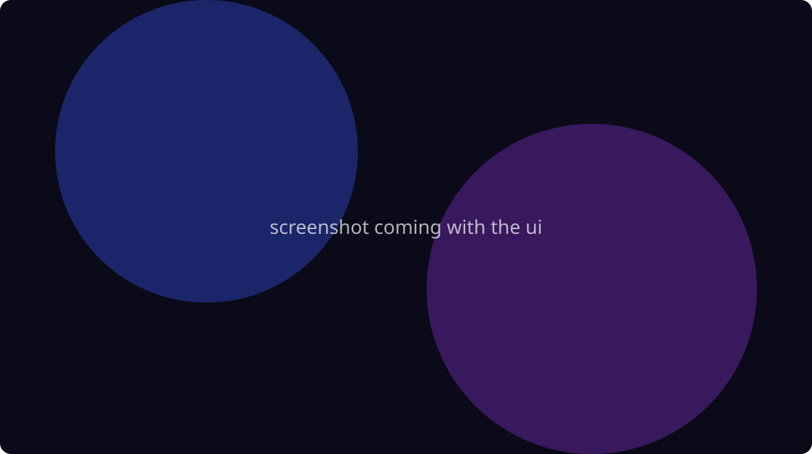

# Shortcuteo

Action shortcuts for Windows. Chain small blocks (set volume, copy text, run PowerShell, open an app...) into a shortcut, then run it from a hotkey, the tray, a schedule or the command line.

Heavily inspired by the Shortcuts app on iOS, built with Tauri 2 and React.



Early work in progress. Nothing is usable yet, see the [changelog](CHANGELOG.md).

## Install

Installers (MSI and NSIS) will be attached to each [release](../../releases) once the first one ships.

To build from source you need Rust (stable), Node 22, the MSVC build tools and WebView2 (preinstalled on Windows 11):

```sh
npm install
npm run tauri dev     # run in dev mode
npm run tauri build   # produce installers in src-tauri/target/release/bundle
```

## Example shortcut

A shortcut is a `.shortcuteo` JSON file. Drop it on the window to import it.

```json
{
  "schemaVersion": 1,
  "id": "clipboard-word-count",
  "name": "Clipboard word count",
  "actions": [
    { "uuid": "clip", "action": "clipboard.get" },
    { "uuid": "words", "action": "scripting.count", "params": { "unit": "words" } },
    {
      "uuid": "toast",
      "action": "notification.show",
      "params": { "title": "Clipboard", "body": "{{output:words}} words" }
    }
  ]
}
```

Each step gets the previous step's output as input, and `{{output:words}}` reuses an earlier result anywhere. More in [`examples/`](examples). The format may still change before 0.1, old files will keep opening.

## Contributing

Adding an action is one Rust file. See [CONTRIBUTING.md](CONTRIBUTING.md).

## License

[MIT](LICENSE)
